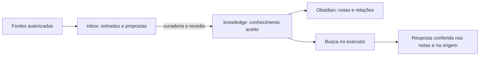

# Second Brain

Uma base pessoal de informação e conhecimento para organizar a vida e o trabalho, recuperar contexto e apoiar decisões com IA. Os arquivos Markdown são a fonte canônica: podem ser lidos, editados, versionados e usados por diferentes assistentes, sem depender do histórico de uma conversa.

O projeto reúne fontes recebidas, conhecimento revisado e relações entre empresas, pessoas, projetos, reuniões e temas. Obsidian permite navegar por essas relações; a busca ajuda a encontrar informações pelo significado. O Dot pode coordenar as tarefas, enquanto o executor segue as instruções e skills desta cópia.

## Como a informação circula



A pessoa solicita uma coleta, organização, consulta ou atualização pela conversa. O assistente identifica o fluxo, lê as fontes disponíveis, esclarece o necessário e mostra o resultado. A curadoria confere o conteúdo antes de incorporá-lo à base; uma consulta recupera candidatos e abre as notas atuais para sustentar a resposta.

Receber um arquivo não inicia processamento em segundo plano. Uma coleta usa somente o recorte autorizado e as ferramentas disponíveis naquele executor. Repetir a coleta deve reconhecer a origem e preservar correções já aceitas.

## O que esta base permite fazer

| Capacidade | Resultado |
|---|---|
| Montar e rever contexto | Perfil com responsabilidades, objetivos, preferências e origem. |
| Receber e coletar informações | Textos, documentos ou recortes de fontes autorizadas, identificados para curadoria. |
| Curar e relacionar conhecimento | Notas revisadas com decisões, pendências, fontes e links entre contextos. |
| Acompanhar mudanças | Atualizar o estado de um projeto sem apagar o registro histórico de uma reunião. |
| Consultar e conferir | Recuperar por significado ou termos exatos e responder com fontes, datas e lacunas. |
| Navegar no Obsidian | Ler notas, seguir links e explorar backlinks e grafos nativos. |
| Sincronizar cópias privadas | Usar Git para trocar versões aceitas; cada executor mantém seu próprio índice. |
| Manter os fluxos | Reproduzir casos fictícios e conferir a integridade de arquivos e relações. |

Agenda e tarefas continuam nas fontes operacionais escolhidas. Briefings e rotinas podem usar o conhecimento desta base quando houver um pedido e os acessos necessários. Conectores, agendamentos e ações em outros sistemas precisam ser preparados e autorizados no ambiente em que serão executados.

## Estrutura do projeto

```text
brain/
├── README.md                 visão geral e como começar
├── AGENTS.md                 regras únicas para o assistente
├── .agents/skills/            onboarding, contexto, curadoria, consulta e testes de fluxos
├── .obsidian/                configuração portável do cofre
├── inbox/                    fontes recebidas e propostas em revisão
└── knowledge/                conhecimento aceito
    ├── empresas/             organizações e suas relações
    ├── pessoas/              identidades e contextos de interação
    ├── projetos/             objetivos, estado e próximos passos
    ├── reunioes/             registros históricos revisados
    └── temas/                assuntos pessoais e profissionais recorrentes

scripts/                      busca e verificações de manutenção
.github/workflows/            verificações no GitHub
.local/                       estado gerado no executor, ignorado pelo Git
```

As pastas de conteúdo já vêm com READMEs. As tarefas criam as notas quando houver informação útil; não é necessário preencher a árvore inteira. A entrevista cria `knowledge/perfil.md`. Uma pessoa ou organização tem uma nota canônica, mesmo quando participa de vários contextos.

As [convenções das notas](knowledge/README.md) definem identidade estável, domínios, relações e origem. `inbox/` preserva entradas e propostas; somente conteúdo aceito em `knowledge/` entra na busca padrão. Modelos, índice e originais locais não versionados ficam em `.local/`, criada conforme a necessidade do executor.

## Começar sua base

Com o Codex aberto, peça:

> Prepare ou reutilize minha cópia privada a partir de https://github.com/vlabsai/executive-brain-template. Confira o destino, clone a cópia e use-a como pasta de trabalho. Leia suas instruções e mostre a estrutura disponível. Preserve os arquivos que já existirem.

Ao começar a trabalhar nesta cópia, as instruções acionam `brain-onboarding`. O assistente confere o ambiente, prepara o que faltar e valida uma busca com dados fictícios temporários, inclusive quando a base ainda estiver vazia. Depois retoma o seu pedido. Nas retomadas, a checagem reutiliza os recursos existentes; não há uma instalação a cada pergunta.

Para montar seu contexto:

> Use a skill start-executive-project para me entrevistar, esclarecer o que faltar e organizar meu perfil nesta base.

A entrevista aproveita o relato existente, pergunta pelo que muda o resultado e apresenta uma síntese. Após a conferência, salva o perfil e preserva ou referencia sua origem. O nome da skill é um identificador de acionamento; o contexto pode cobrir responsabilidades pessoais e profissionais.

Depois, faça pedidos conforme a necessidade:

- **Organizar:** “Organize este documento na minha base. Quero reencontrar as decisões, dúvidas e próximos passos. Mostre a proposta antes de incorporar.”
- **Atualizar:** “Este registro traz uma mudança no projeto. Compare com as notas existentes, preserve o histórico e mostre o que precisa ser atualizado.”
- **Consultar:** “O que preciso acompanhar neste projeto? Mostre as fontes, a data de referência e o que ainda falta confirmar.”

Forneça o texto, arquivo ou identificação da fonte autorizada. O assistente encaminha a curadoria e a consulta pelos fluxos do projeto. Se a skill não aparecer no seletor, peça que leia o `SKILL.md` correspondente nesta cópia.

Use uma cópia privada para informações reais. O template público e seus forks públicos recebem somente material genérico ou fictício. Clonar o repositório não instala a busca nem conecta contas.

## Fluxos disponíveis

| Skill | Quando usar |
|---|---|
| [brain-onboarding](.agents/skills/brain-onboarding/SKILL.md) | Preparação inicial e conferência do executor antes de usar a base. |
| [start-executive-project](.agents/skills/start-executive-project/SKILL.md) | Acionamento explícito para montar ou rever seu perfil e contexto. |
| [brain-curate](.agents/skills/brain-curate/SKILL.md) | Incorporar ou atualizar informações, por pedido natural, com curadoria e revisão. |
| [brain-query](.agents/skills/brain-query/SKILL.md) | Consultar as notas e conferir afirmações nas fontes. |
| [brain-evaluate](.agents/skills/brain-evaluate/SKILL.md) | Quem mantém os fluxos reproduz casos fictícios e confere seu comportamento. |

Os fluxos são independentes: uma consulta não exige repetir a entrevista, e curar uma informação não inicia outra atividade por conta própria. As regras compartilhadas ficam em [AGENTS.md](AGENTS.md); cada skill descreve o procedimento da sua tarefa.

## Obsidian, busca e ambientes

Abra a raiz da cópia privada como cofre no Obsidian. Links Markdown, propriedades, backlinks e grafo funcionam com recursos nativos. A configuração foca `knowledge/` e oculta READMEs no grafo; estado de janela e preferências pessoais ficam fora do Git.

A [busca no executor](.agents/skills/brain-query/references/search.md) usa QMD 2.8.3 com embeddings locais, sem serviço próprio. O assistente prepara ferramentas e modelos conforme essa referência. Antes de consultar, o helper atualiza o índice e os embeddings necessários; depois, o assistente abre as notas atuais para conferir o que foi recuperado. Similaridade ajuda a encontrar, mas não comprova um fato.

O executor pode ser o computador pessoal ou um ambiente remoto preparado. O Dot coordena pedidos; o executor lê esta cópia, usa seus próprios acessos e executa as tarefas. Git sincroniza as notas aceitas entre cópias privadas. Credenciais, modelos e índices não são compartilhados pelo clone e precisam de preparação própria em cada ambiente. Atualizações recebidas por Git ou feitas no Obsidian precisam chegar ao índice antes da próxima consulta.

## Manutenção

Para conferir o framework e a integridade de uma base preenchida:

```sh
python3 scripts/validate.py --notes
python3 -m unittest discover -s scripts -p 'test_*.py'
```

O validador confere recursos, ids e links; não aprova fatos ou comprova acessos. Para testar o comportamento de uma skill, use `brain-evaluate`: seus casos fictícios, critérios e preparador ficam no próprio pacote. A avaliação é acionada na manutenção dos fluxos, sem exigir relatórios ou testes a cada nota.

Mudanças do template não atualizam automaticamente cópias existentes. Compare os arquivos comuns e preserve as notas, instruções específicas e configurações da sua base antes de incorporar uma atualização.
